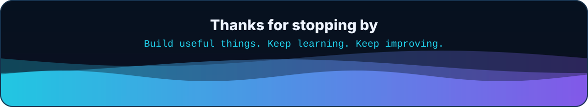

<!-- GENERATED by build.py from profile.json - edit profile.json, then run: python build.py -->

   

 

<table>
<tr>
<td width="46%" valign="top">

</td>
<td valign="top">

I'm **Susitha Shehan**, a **Junior Software Developer at [QTLabX](https://qtlabx.com/about)** and a passionate builder behind **Rabio Software Solutions**. I enjoy turning ideas into practical, well-designed applications and continuously improving my skills in software engineering, design, and problem solving.

| | |
|:--|:--|
| **Role** | Junior Software Developer |
| **Company** | [QTLabX](https://qtlabx.com/about) |
| **Building** | Rabio Software Solutions |
| **Location** | Sri Lanka |

**Interests**

- Full-stack development
- Web applications
- Mobile applications
- Responsive UI/UX
- Scalable backend systems

</td>
</tr>
</table>

 

<b>Text version of the tech stack</b>

- **Languages:** HTML5, CSS3, JavaScript, TypeScript, Java, Python, C#, PHP
- **Frameworks:** React, Next.js, Node.js, NestJS, Express, React Native, Flutter
- **Data & Tools:** MySQL, PostgreSQL, MongoDB, Firebase, Git, Docker, AWS, Figma

 

| Area | What I'm focused on |
|:--|:--|
| **QTLabX** | Growing as a Junior Software Developer |
| **Rabio Software Solutions** | Building a stronger software brand and project portfolio |
| **Development** | Full-stack apps, clean architecture, and better UI/UX |
| **Learning** | Sharpening engineering skills through real projects |

 

 

<picture>
  <source media="(prefers-color-scheme: dark)" srcset="https://raw.githubusercontent.com/Shehan1205/Shehan1205/output/github-snake-dark.svg" />
  <source media="(prefers-color-scheme: light)" srcset="https://raw.githubusercontent.com/Shehan1205/Shehan1205/output/github-snake.svg" />
  
</picture>

> Stats cards are third-party services reading the public activity of **@Shehan1205**; the snake needs the workflow in `.github/workflows/snake.yml` to run once.

 

 

   

  

 

