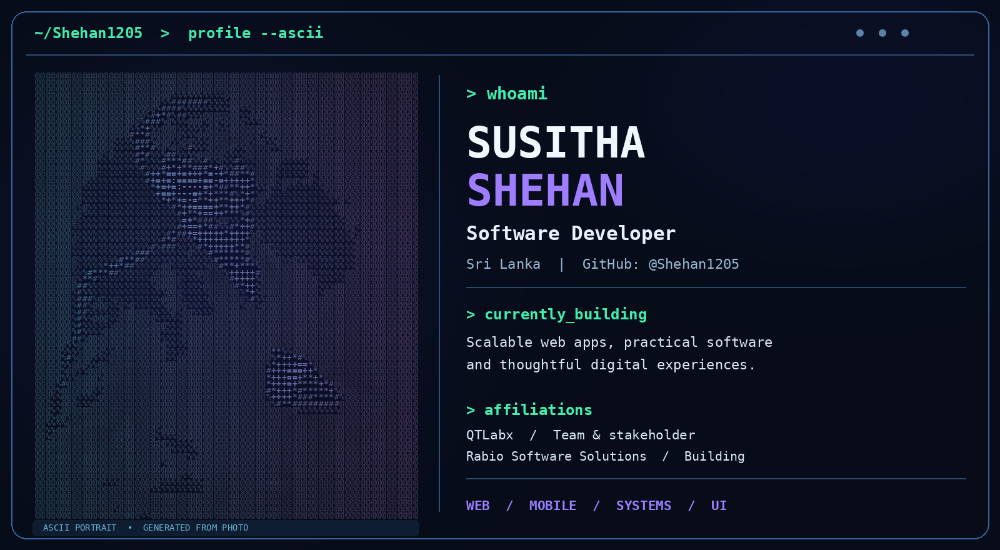

### Hey, I'm Susitha Shehan 👋

**Software Developer · Building practical digital experiences**

Based in **Sri Lanka** 🇱🇰 · [QTLabx](https://qtlabx.com/about) · Building **Rabio Software Solutions**

---

### `> about_me`

I'm a software developer who enjoys turning ideas into useful, well-designed applications. I am involved with **[QTLabx](https://qtlabx.com/about)** as a stakeholder and am developing **Rabio Software Solutions** as my own growing software brand.

I'm interested in **full-stack applications, software architecture, responsive user experiences, and building products that solve real-world problems**.

### `> tech_stack`

<!-- Technologies discussed during project planning; adjust this list to reflect your hands-on proficiency. -->

**Frontend**

**Backend & Database**

**Tools & Design**

### `> what_im_building`

| Project | What it is | Status |
|:--|:--|:--|
| **OMS — Order Management System** | Planning and building a multi-tenant platform for orders, stock, shipments, and payment workflows. | 🚧 In development |
| **Rabio Software Solutions** | Developing a modern software brand and animated portfolio experience. | 🚧 In development |

> Project source links will be added once public repositories are ready. Private code and work-in-progress features are not claimed as completed releases.

### `> github_activity`

  

  
More about my developer journey

   
  I enjoy learning new technologies, improving my engineering process, and experimenting with thoughtful UI and animation. My main focus is on building secure, scalable, maintainable applications.

---

  Made with 💜 by <a href="https://github.com/Shehan1205">Susitha Shehan</a> · Building, learning, improving.

