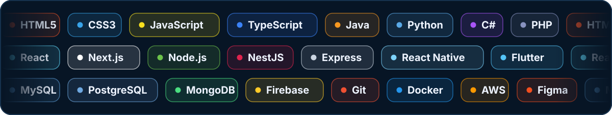

<!-- Regenerated premium GitHub profile for Shehan1205 -->
<div align="center">



# Hi, I'm Susitha Shehan 👋
### `Junior Software Developer at QTLabX`  •  `Building Rabio Software Solutions`

[](https://github.com/Shehan1205)
[](https://qtlabx.com/about)
[](https://www.facebook.com/share/1FMpHUwEFh/)
[](https://www.facebook.com/share/1CEm1T7WZY/)


</div>

---

## `01 / portrait_ascii`

> This portrait is generated from my actual photo using only text characters. It is not an embedded photo.

```text
+----===+: =@*---===+%%=--==-=*%%%%#=.  ..:-======-::=#####*=-::-==*%%*-:-=-:---
+-----==+=-*@#=--==+*%@*--====#%%%%%#+---::-=======+*#%%%%##*=::-=+#%@%%#*=-----
#+----==+#@@@%=:-==*%@@#---==+#%%%%###*+-::--=======*#%%%%%#*=::-==*##*+=-:..
#=-:---=+#@@@@+::-=*%@@%=:-==+#%%%%%#*+=-:::--:::::-=+*++====-:.:::.  ..
*=-:::-=+*%@@@+::-=+#@@%=..:-=++=====::.            .-.     ::.....   ..
*=-:..:-=*#%@%+::--+#@@#-...:=-.   ..                :      .::....   ::.
+=-...:-=+#%@%+:::-=*@@#-...:--    .::.             .:      .::..:.   :-:.
*=-...:-=+#%@%*-::-=*@@%-...:==-::::--:.... ..       :.      ::..::   --:.
*+-...::=+#%@@*-::-=*%@%-.:-+*####%%%%####****+-.   .-:     .::..... .-=:.
*+-:..::-+#%@@#-.::-+%@%==###%@@@@@@@@@@@@@@@@@@%*: .-=-:. .:::...:..:=+=:
*+-:...:-+*%@@#-..:-+%@%%**%@@@@@@@@@@@@@@@@@@@@@@%*==++=-::--:...:--=++=-.
#+-:...:-=*%@@%=..:-+%%@**%@@@@@@@@@@@@@@@@@@@@@@@@@%#*++====-:..::-+*#*+=:
#*-:...:-=*%@@%=:.:-#%@@%@@@@@@@@@@@@@@@@@@@@@@@@@@@@@%*++====:..::-+###*=-.
**=:...:-=*%@@%=::-#%%@@@@@@@@@@@@@@@@@@@@@@@@@@@@@@@@@%++==+=:..::-+#%#*+-:.
**=:...:-=*%@@%+:+#@@@@@@@@@@@@@@@@@@@@@@@@@@@@@@@@@@@@@#===+=:...:-=#%#*+-:.
*+=:...::-+%@@%+:=#%@@@@@@@@@@@@@@@@@@@@@@@@@@@@@@@@@@@@@*====:...:-=*#%#+=:..
*+=:....:-+%@@@+::=*#%%%%@@@@@@@@%@@@@@@@@@@@@@@@@@@@@@@@@*+==:...:--+#%#+=-..
++-:...::-+%@@@*:.:-+#%@%%#*#%%%%%@@@@@@@@@@@@@@@@@@@@@@@%*+==:. .::-+#%#+=-..
+=-:....:-+#@@@*:..-#%#%%#=*+==+*##%#**@@@@@%@@#@@@@@@@@@#=-==:. ..:-+#%#+=-..
+=-:....:-=#@@@*:..+#%%%#*:+*-=*=*%*####=*@@%%%*%%%@@@@@@%-:--:. ..:-+#%#+=-.
+=-:....:-=#@@@*:..=##****=.-----=**+=#:.:=%%######%@@@@@@+:--:.  .:-+###+=-.
+=-:....::=#@@@#:...=-=.:--  ::---====-  .:-+++++++*@@@@@@=.:-:   ..:=*##+=-:
+==:....::=*@@@#-...::+.-=:.  .::::--:.:.:-++==---=+%@@@@*..:-:   ..:-+##+=-:
++=:.....:-*@@@#-...:--:=-.:.   ......-=+*###+++=--=%%%%=...:-:    .:-+*#*=-:
++=-.....:-*%@@%=...:-=-:.::-.    .:=+==+*****%@#==*%%%+. ...::    .:-+##*=-:
+++-.....:-*%@@%=....:+#-..:=...  .=##+===++++++++*#%@%+:. ..::.   .:-+##*=-:
+++-.....:-*%@@%=. ..:+%#: -*-:-:..------=**+====*#%*+=-:.  .::.   .:-+##*+-:.
*++-.....:-+%@@%+. ..:=%#- .=#=--:--:::---======*%%+ .--:.  .::.   .:-+##*+-:.
*++-.....:-+%@@%+.  .:=#%-  .-+.-++++=--=+**###%@%*  .--:.  .::.    .-+*#*+=:.
*++-. ...:-+%@%%+.  .:=#%-    :. :=+**##%@@@@@@%*+=:..--:.. .::.    .-+*#*+=:.
*++-. ...::=%@%%+:  .:-#%=   -**..---==+#%%%%#*+====-#+-.....::.   .:-=*#*+=:.
*++-. ....:=#@%%*:  ..-*%=  **%@:--------==+++====++.-%@+::..::.    .:=*#*+=:
*++-.  ...:=#@%%*:  ..-*%= =@##@-.-=-------=+==+++%+  .*@@@@%%%%#########*+=:
*++=:  ...:=#%%%*-  ..:+#=-%@%@@=. .-------===+++##.....+@@@@@@@@@@@@@@@@@%*=:.
***=:  ...:-#%%%#-   .-*%%#@@%@%=:.  .:===-==+++##:......#@@@@@@@@@@@@@@@@@@@@%*
***+:. ...:-#%%%#=:-+#@@@@%@@@@#+-:..   :=++++**=..:.....%@@@@@@@@@@@@@@@@@@@@@@
***+:. ...:-*%%%%%%@@@@@@@@@@@@@+-::......:=+*=:.-+**#%#-@@@@@@@@@@@@@@@@@@@@@@@
***+-.   .:+#%@@@@@@@@@@@@@@@@@@@+:..+%%%%%#%###%@@@@@@@%@@@@@@@@@@@@@@@@@@@@@@@
***+-. .-*%%@@@@@@@@%%%%%@@@@@@@@@#-:%@@@@@@@@@@@@@@@@@@@@@@@@@@@@@@@@@@@@@@@@@@
***+=-+#%@@@@@@@@@@@@@%%@@@@@@@@@@@@=+@@@@@@@@@@@@@@@@@@@@@@@@@@@@@@@@@@@@@@@@@@
***++*@%%%%%%@@@@@@@@@@@@@@@@@@@@@@@@*%@@@@@@@@%*@@@@@@@@@@@@@@@@@@@@@@@@@@@@@@@
*+++=*#%%%%%%@@@@@@@@@@@@@@@@@@@@@@@@@+*%@@@@@@%=#@@@@@#+@@@@@@@@@@@@@@@@@@@@@@@
+++==*#%@%%%%%@@@@@@@@@@@@@@@@@@@@@@@@%=-=+*#%@=:-+%%*=--%@@@@@@@@@@@@@@@@@@@@@@
===::-+*%@%%%%@@@@@@@@@@@@@@@@@@@@@@@@@%-::::::.-.:--:--:*@@@@@@@@@@@@@@@@@@@@@@
-==-: ..=%@@%%@@@@@@@@@@@@@@@@@@@@@@@@@@%-.....:%+.:..-::-@@@@@@@@@@@@@@@@@@@@@@
====++::.=%@@%%@@@@@@@@@@@@@@@@@@@@@@@@@@#-.....:. :..-:.-@@@@@@@@@@@@@@@@@@@@@@
+===+#-:::#@@%%%*+==*@@@@@@@@@@@@@@@@@@@@@#:..:.   .: ::.-@@@@@@@@@@@@@@@@@@@@@@
+===*#-:::+@@#=::--====+%@@@@@@@@@@@@@@@@@@*:.:.   .. .::-%@@@@@@@@@@@@@@@@@@@@@
+=-+*#:.:::=:::--=+----=+*%@@@@@#++#@@@@@@@@+.::.   . .-:-%@@@@@@@@@@@@@@@@@@@@@
==-+*#:.:...::---:::=++---+%%#+--:-#@@@@@@@@@-.:..... .-::*@@@@@@@@@@@@@@@@@@@@@
=--+*#=::.:.:::-::-=+=--**==-:-+#%@@@@@@@@@@@%-::......--:=@@@@@@@@@@@@@@@@@@@@@
=--*#**:::::------===-=**--++*%@@@@@@@@@@@@@@@#-::+:...---:%@@@@@@@@@@@@@@@@@@@@
=-=*#**-::::--=======+*+==*%@@@@@@@@@@@@@@@@@@@*:-#=...:--:#@@@@@@@@@@@@@@@@@@@@
--=##*#=:----====+++**+=+#@@@@@@@@@@@@@@@@@@@@@@+::..:.:=--%@@@@@@@@@@@@@@@@@@@@
::+#***=----====++++++=*@@@@@@@@@@@@@@@@@@@@@@@@@=::.:.:===@@@@@@@@@@@@@@@@@@@@@
 .+*+**#+--====++++++*%@@@@@@@@@@@@@@@@@@@@@@@@@@%-:::::==*@@@@@@@@@@@@@@@@@@@@@
  =++%%=+#*=-===++#%@@@@@@@@@@@@@@@@@@@@@@@@@@@@@@#-::::-=%@@@@@@@@@@@@@@@@@@@@@
 .=+*#@#=*%##**+#@@@@@@@@@@@@@@@@@@@@@@@@@@@@@@@@@@*::::-*@@@@@@@@@@@@@@@@@@@@@@
 .=+#*@@%####@@#%@@@@@@@@@@@@@@@@@@@@@@@@@@@@@@@@@@@+--:-#@@@@@@@@@@@@@@@@@@@@@@
..=**+*@@@%%##**%@@@@@@@@@@@@@@@@@@@@@@@@@@@@@@@@@@@@+--=@@@@@@@@@@@@@@@@@@@@@@@
..****+*@%#*##%%@@@@@@@@@@@@@@@@@@@@@@@@@@@@@@@@@@@@@@=-*@@@@@@@@@@@@@@@@@@@@@@@
.-#******%@@@@@@@@@@@@@@@@@@@@@@@@@@@@@@@@@@@@@@@@@@@@%=@@@@@@@@@@@@@@@@@@@@@@@@
.+*****#%#%@%@@@@@@@@@@@@@@@@@@@@@@@@@@@@@@@@@@@@@@@@@@%@@@@@@@@@@@@@@@@@@@@@@@@
```

---

## `02 / about_me`

```yaml
name: Susitha Shehan
role: Junior Software Developer
company: QTLabX
building: Rabio Software Solutions
location: Sri Lanka
interests:
  - Full-stack development
  - Web applications
  - Mobile applications
  - Responsive UI/UX
  - Scalable backend systems
```

I'm **Susitha Shehan**, a **Junior Software Developer at [QTLabX](https://qtlabx.com/about)** and a passionate builder behind **Rabio Software Solutions**. I enjoy turning ideas into practical, well-designed applications and continuously improving my skills in software engineering, design, and problem solving.

---

## `03 / programming_languages_and_technologies`

<div align="center">

</div>

<details>
<summary><b>Text version of the tech stack</b></summary>

- **Frontend:** HTML, CSS, JavaScript, TypeScript, React, Next.js
- **Backend:** Node.js, NestJS, Express, Java, Python, C#, PHP, Firebase
- **Mobile:** React Native, Flutter
- **Databases:** MySQL, PostgreSQL, MongoDB
- **Tools & Design:** Git, Docker, AWS, Figma

</details>

---

## `04 / current_focus`

| Area | What I'm focused on |
|:--|:--|
| **QTLabX** | Growing as a Junior Software Developer |
| **Rabio Software Solutions** | Building a stronger software brand and project portfolio |
| **Development** | Full-stack apps, clean architecture, and better UI/UX |
| **Learning** | Sharpening engineering skills through real projects |

---

## `05 / featured_projects`

### `OMS — Order Management System`
A multi-tenant system being built to handle **orders, shipments, payments, inventory flow, and business operations**.

**Stack:** `Next.js` `NestJS` `PostgreSQL` `Redis` `TypeScript`

### `Rabio Software Solutions`
A growing software brand focused on **web applications, mobile apps, business systems, UI/UX, and digital products**.

**Focus:** `Web` `Mobile` `POS` `OMS` `E-Commerce` `UI/UX`

---

## `06 / github_activity`

<div align="center">


</div>

> GitHub stats above are third-party generated cards based on the public activity of **@Shehan1205**.

---

## `07 / developer_console`

```console
$ whoami
Susitha Shehan

$ role --current
Junior Software Developer at QTLabX

$ project --building
Rabio Software Solutions

$ mindset
Build useful things. Keep learning. Keep improving.
```

---

## `08 / connect_with_me`

<div align="center">

[**GitHub**](https://github.com/Shehan1205) • [**QTLabX**](https://qtlabx.com/about) • [**Personal Facebook**](https://www.facebook.com/share/1FMpHUwEFh/) • [**Rabio Facebook**](https://www.facebook.com/share/1CEm1T7WZY/)


</div>
